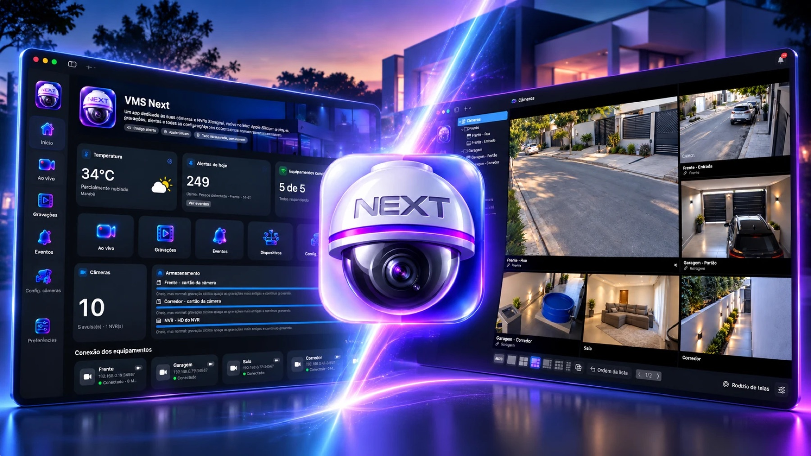
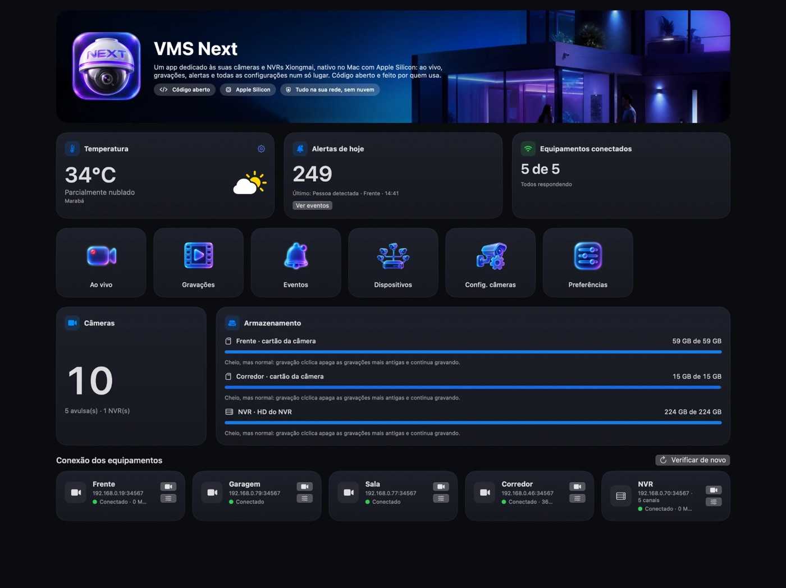
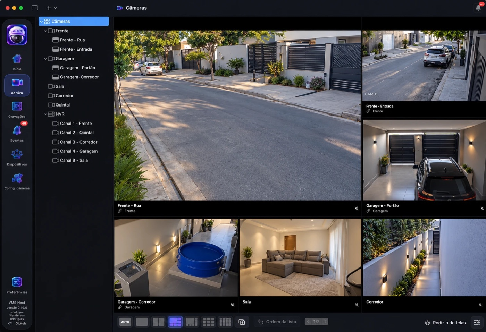
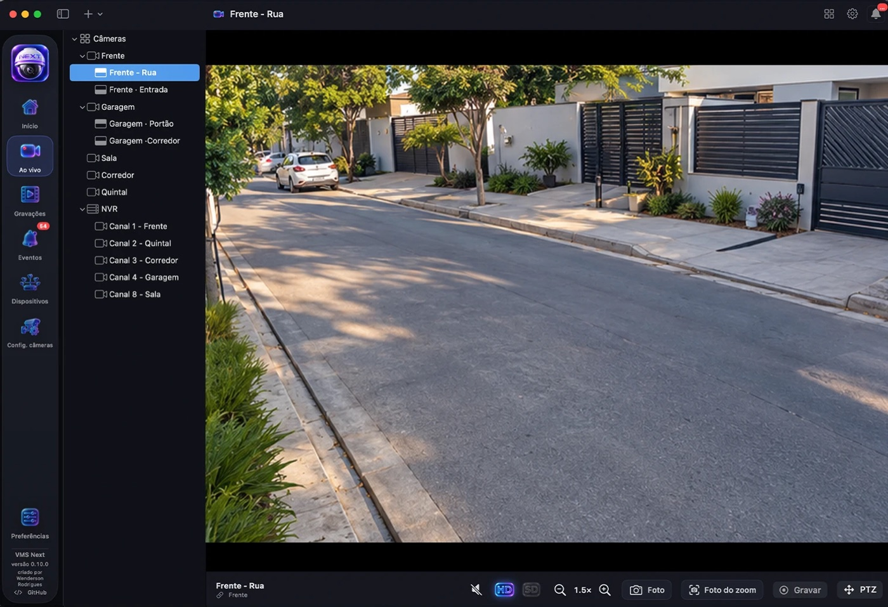
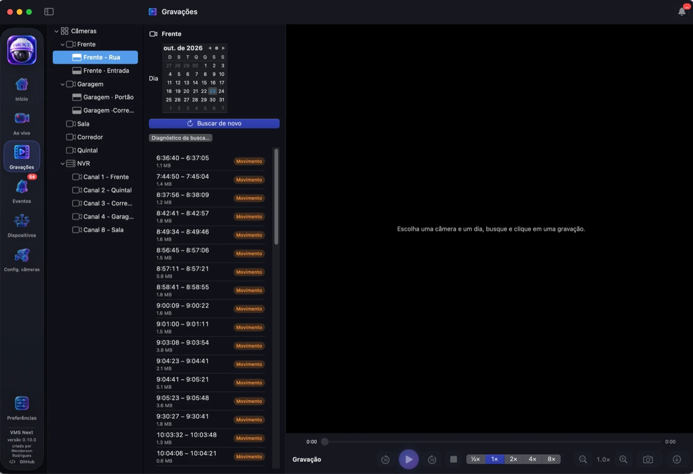
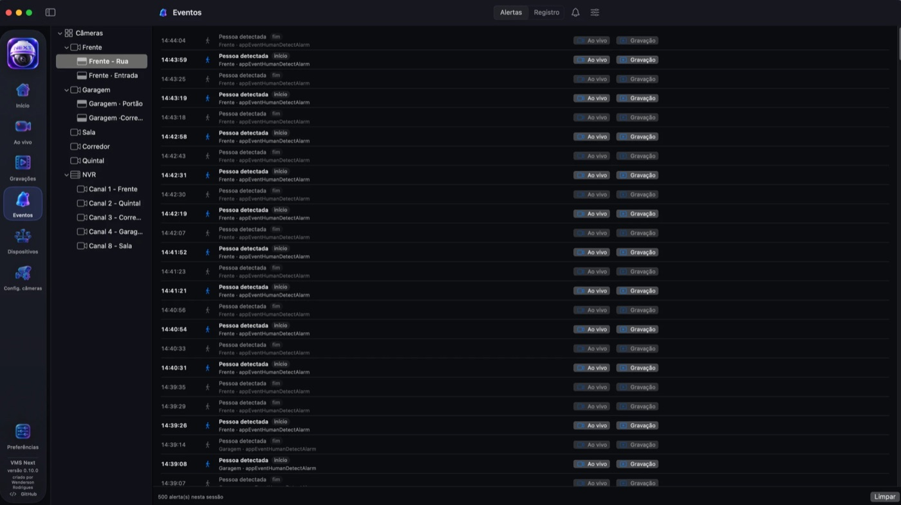
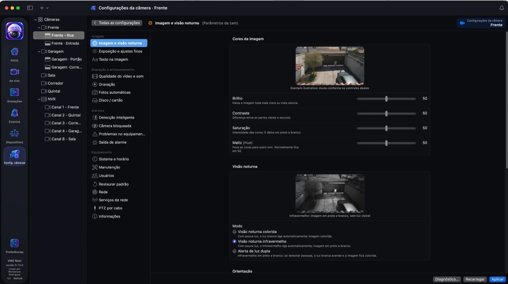
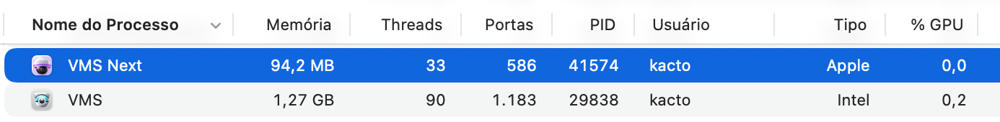

# VMS Next - iCSee/XMEye for MacOs

<p align="center">
  
</p>

App nativo para **Mac com Apple Silicon** dedicado a câmeras e NVRs (XMEye / iCSee), feito em Swift e SwiftUI.

Reúne num só lugar o ao vivo, as gravações, os alertas e todas as configurações dos equipamentos. Roda em arm64, decodifica vídeo pelo hardware do chip M e conversa direto com as câmeras pela rede local, sem nuvem e sem o SDK da fabricante. Cobre as funções do VMS para Mac (app para Intel, que depende do Rosetta) e acrescenta outras.

[](https://github.com/wendersonrodrigues/vms-next/releases/latest)
[](LICENSE)


## Telas

<table>
  <tr>
    <td width="50%"><br><sub><b>Início</b>: clima, alertas, discos e conexão dos equipamentos</sub></td>
    <td width="50%"><br><sub><b>Ao vivo</b>: modelos de tela, split virtual e rodízio</sub></td>
  </tr>
  <tr>
    <td><br><sub><b>Câmera em tela cheia</b>: som, HD/SD, zoom, foto, gravar e PTZ</sub></td>
    <td><br><sub><b>Gravações</b>: busca por dia, player, zoom, foto e MP4</sub></td>
  </tr>
  <tr>
    <td><br><sub><b>Eventos</b>: alertas com atalhos para o ao vivo e a gravação</sub></td>
    <td><br><sub><b>Configurações</b>: ajustes com prévia ilustrada</sub></td>
  </tr>
</table>

## Desempenho

Os dois apps abertos ao mesmo tempo no mesmo Mac, no Monitor de Atividade:

<p align="center">
  
</p>

| | VMS Next | VMS antigo (V2.2.1.1) |
|---|---|---|
| Memória RAM | **94,2 MB** | 1,27 GB |
| Threads | **33** | 90 |
| Portas | **586** | 1.183 |
| Arquitetura | **Apple Silicon (nativo)** | Intel (via Rosetta) |

O VMS Next usou **cerca de 13 vezes menos memória RAM**, menos da metade das threads e das portas. Ele roda direto no chip da Apple e decodifica o vídeo pelo hardware, sem a camada de tradução do Rosetta. É uma medição de um momento; os números mudam conforme quantas câmeras estão na tela.

## Instalação

1. Baixe o **`VMS-Next-<versão>.dmg`** na página de [Releases](https://github.com/wendersonrodrigues/vms-next/releases/latest) e abra o arquivo.
2. Na janela que abre, **arraste o VMS Next para a pasta Aplicativos** (a seta mostra o caminho). Depois pode ejetar o "VMS Next" na barra lateral do Finder. Também há um `.zip` para quem preferir.
3. **Primeira abertura:** o app ainda não tem assinatura da Apple, então o macOS avisa que o desenvolvedor não foi identificado. Clique com o **botão direito** no app → **Abrir** → **Abrir**. Se o macOS não oferecer a opção, vá em **Ajustes do Sistema → Privacidade e Segurança** e clique em **Abrir Mesmo Assim**. Isso só é preciso uma vez.
4. Permita o acesso à **Rede local** quando o macOS pedir: é assim que o app fala com as câmeras.
5. Crie o **login do VMS Next** (usuário e senha só deste app). Ele protege o cofre onde ficam as senhas das câmeras.

## Primeiros passos

1. **Adicionar câmeras:** vá em **Dispositivos → Procurar na rede**. Aparecem as câmeras e NVRs Xiongmai da sua rede; clique em **Adicionar…**, confira o nome e digite o **usuário e a senha do equipamento** (os mesmos do iCSee/XMEye). Também dá para adicionar pelo IP com **+ → Nova câmera**.
2. **Ver ao vivo:** clique em **Ao vivo** (⌘2). Escolha o modelo de tela na barra de baixo e arraste câmeras da lista para os quadros. Cada quadro tem embaixo o nome, o **PTZ** (nas câmeras que têm), o som e o botão **expandir**, que abre a câmera em tela cheia (duplo clique também abre).
3. **Câmera dupla** (duas imagens uma em cima da outra): botão direito → **Dividir em duas (split virtual)**.
4. **Gravações:** clique em **Gravações**, escolha a câmera na lista e o dia. Clique numa gravação para assistir; **Baixar** salva em MP4.
5. **Alertas:** em **Eventos → Ajustes dos alertas** escolha quais tipos notificam e tocam som. Cada alerta tem atalhos para o **ao vivo** e para a **gravação** daquele momento.
6. **Configurar uma câmera:** clique em **Configurações** e escolha a câmera ou o NVR na lista. Só aparecem as opções que o equipamento tem.
7. **Preferências (⌘,):** pastas de fotos e downloads, gravação no Mac, tema e segundo plano.

### Dúvidas comuns

- **"Senha não definida" ou a câmera não conecta:** botão direito na câmera → **Editar…** e confira o usuário e a senha. Depois de uma senha errada, o app espera você corrigir antes de tentar de novo, para a câmera não bloquear o usuário.
- **NVR recusa o login:** no menu de rede do NVR, deixe **Criptografia de rede** em **"Login remoto precisa de criptografia"**.
- **A busca na rede não acha nada:** o Mac precisa estar na mesma rede das câmeras e o VMS Next precisa da permissão de **Rede local** (Ajustes do Sistema → Privacidade e Segurança → Rede Local).
- **Ver de fora de casa:** o VMS Next conecta pelo IP. Use uma VPN para a sua rede (por exemplo Tailscale ou WireGuard no roteador).
- **Levar para outro Mac:** **+ → Exportar câmeras** e, no outro Mac, **Importar câmeras**. As senhas não vão no arquivo.

## Funcionalidades

### Início
- Painel com **temperatura** da sua cidade, **alertas de hoje**, **equipamentos conectados**, total de câmeras e **armazenamento** de cada disco, com a origem (HD do NVR ou cartão da câmera) e o tipo de gravação (cíclica ou para quando enche).
- **Conexão de cada equipamento** (conectado, sem conexão e o motivo) com atalhos para o ao vivo e as configurações.
- Menu de ícones para todas as áreas do app.

### Ao vivo
- **Modelos de tela**: Auto (todas as câmeras no melhor tamanho), 1, 4, 1 grande + 5, 1 grande + 7, 9 e 16, em botões na barra de baixo.
- **Arrastar e soltar** câmeras da lista para os quadros; cada modelo guarda as posições.
- **Modelos personalizados**: grade de até 6 × 6 com quadros juntados.
- **Rodízio de telas** (Tour): passa sozinho pelas telas escolhidas, com tempo ajustável.
- **Split virtual** para câmeras duplas: uma imagem vira dois quadros (cima e baixo) com um só vídeo da câmera, nomes próprios e o nome oficial sempre junto.
- Barra embaixo de cada quadro do mosaico: nome (e a câmera ligada, nas metades do split), **PTZ**, **som** e **expandir**.
- **Zoom digital** em cada quadro e na câmera em tela cheia (botões, pinça no trackpad e arrastar).
- Câmera em tela cheia com barra de baixo: **som**, **HD/SD**, **foto**, **Gravar** e **PTZ**.
- **PTZ** no pé da lista de câmeras, uma câmera por vez, no arranjo do VMS antigo: 8 direções, zoom óptico, íris, foco, passo, **presets** e **ronda** (com janela de edição), escolhidos numa lista. Inverter esquerda/direita e cima/baixo por câmera. O botão só aparece nas câmeras com PTZ (automático ou escolhido em Editar câmera).
- **Áudio** G.711 das câmeras, um som por vez.
- Lista de câmeras **reordenável** arrastando; NVR como grupo com seus canais.
- Vídeo H.264 e H.265 por RTSP ou pelo protocolo Xiongmai, com reconexão automática.

### Gravações
- A câmera vem da lista ao lado e a busca do dia é automática.
- Reprodução com pausa, saltos de 10 s, barra de progresso, velocidade de ½× a 8× e som.
- **Download em MP4** (vídeo sem recomprimir e som em AAC).
- **Zoom digital** e **foto do quadro**, inteira ou só da parte ampliada.

### Gravação no Mac
- Botão **Gravar** em cada câmera: grava o vídeo principal em MP4 no disco do Mac.
- **Gravação automática** por horário, para todas as câmeras ou só as escolhidas.
- Arquivos de 5 a 120 minutos, reserva de espaço livre e, com o disco cheio, parar ou apagar as mais antigas.

### Eventos
- Alertas das câmeras e do NVR, **guardados no Mac** entre aberturas.
- Em cada alerta: **Ao vivo** e **Gravação** (abre a gravação no momento do alerta).
- **Notificações do macOS** e **som no Mac** por tipo de alerta (sons do sistema ou arquivo próprio).
- **Alertas repetidos juntados** quando a mesma câmera avisa por ela e pelo NVR.
- **Registro**: o que aconteceu no app (entradas, configurações alteradas, reinícios, fotos, downloads) e o registro guardado em cada equipamento, com filtro por data e tipo e exportação em CSV.

### Dispositivos
- **Procurar na rede** (IPV4 pesquisar): encontra câmeras e NVRs Xiongmai da rede local, com IP, MAC e CloudID.
- Lista dos equipamentos cadastrados, com editar e configurações.
- **Importar e exportar** a lista de câmeras para outro Mac (sem as senhas).
- Senha salva visível no editor (botão de olho).

### Configurações (das câmeras)
Configurações embutidas na janela, para a câmera, o NVR ou o canal escolhido na lista. Começam num menu de ícones e mantêm a tela aberta ao trocar de câmera. Só aparecem as telas e opções que o equipamento informa ter (capacidades `SystemFunction`, `EncodeCapability` e outras). Os valores e as regras de cada tela foram conferidos no próprio código do VMS antigo (mapa em [docs/REA-MAPA-CONFIG.md](docs/REA-MAPA-CONFIG.md)).

- **Imagem e visão noturna**: brilho, contraste, saturação, matiz, espelhar, virar, contraluz, anti-cintilação e os modos de visão noturna (colorida, infravermelha e luz dupla), com **prévia ilustrada** de cada ajuste.
- **Exposição e ajustes finos**: modo de exposição com os tempos da câmera, ganho, faixa dinâmica (WDR), ruído, estilo e filtro IR.
- **Texto na imagem** e máscaras de privacidade.
- **Qualidade do vídeo e som**: seletor de canal (câmeras de lente dupla), compressão (H.265X/H.265), resolução, qualidade, FPS, CBR/VBR, taxa de bits, intervalo de quadro, áudio, perfil e Smart Encode (H265AI), com aviso para reiniciar.
- **Gravação** com agenda semanal pintável, **Fotos automáticas** e **Disco / cartão**.
- **Alarmes**: detecção inteligente com área e linha de aviso, perda de vídeo, câmera bloqueada, veículos, problemas no equipamento e saída de alarme.
- **Equipamento**: sistema e horário (com fuso horário e servidor de horário), manutenção, usuários, restaurar padrão, rede, serviços de rede (nuvem, RTSP, filtro de IP, Wi-Fi, notificações no celular), **PTZ por cabo** (RS485) e informações.
- **Diagnóstico** em JSON (sem senhas) em cada tela, e **Capacidades…** em Informações.

### Acessibilidade e teclado
Interface revista pelas regras da Apple para o macOS ([docs/REVISAO-INTERFACE-MACOS.md](docs/REVISAO-INTERFACE-MACOS.md)).
- Cores com contraste mínimo também no modo claro e reforçadas com **Aumentar contraste**; respeita **Reduzir movimento**.
- **VoiceOver** em português em todos os botões, nos quadros de vídeo (estado e ações), no PTZ, na agenda e nos editores.
- Atalhos: **⌘,** Preferências · **⌘1–⌘6** telas · **⌥⌘← ⌥⌘→** páginas do mosaico · **⌥⌘↑** voltar ao mosaico · **⌥⌘R** rodízio · nas Gravações **espaço**, **← →** e **⌘D** · **⌘R** recarregar as configurações.

### Preferências
- Tema claro, escuro ou igual ao Mac.
- Pastas de fotos, downloads e gravações, e se pergunta onde salvar.
- Voltar para onde parei, lembrar login, acertar o relógio das câmeras, qualidade ao abrir uma câmera.
- Captura automática de fotos, quantos alertas guardar e por quanto tempo guardar o registro.
- Segundo plano: ícone na barra de menus, alertas com a janela fechada, abrir junto com o Mac e esconder do Dock.

### Segurança
- Tudo roda na **rede local**; nada vai para a nuvem.
- Login no app e senhas das câmeras num **cofre criptografado** (AES-GCM, chave derivada da senha do VMS Next), só neste Mac.
- Depois de uma senha recusada, o app **não repete o login** até a senha ser trocada, para a câmera não bloquear o usuário.
- Configurações gravadas no modo *ler, alterar e devolver*: campos que o app não conhece são preservados.
- Diagnósticos e exportações nunca incluem senhas.

## Próximos passos

O que está nos planos (ideias e pedidos são bem-vindos nas *Issues*):
- PTZ pelas setas do teclado e **Return** para abrir a câmera escolhida no mosaico.
- **Delete** para apagar itens nas configurações (máscaras, usuários, passos do rodízio).
- Opção **H265+** da codificação inteligente e conferência do perfil de codificação em mais modelos.
- Aba **Wi-Fi** completa (procurar redes e trocar de rede com segurança).
- **Filtro de IP** e **horário de verão** editáveis.
- Trocar o IP de uma câmera pelo NVR e **atualizar o firmware** pelo app.
- Mais preferências do VMS antigo (conectar sozinho, trocar HD/SD automático).
- Testes com mais modelos de câmeras e NVRs Xiongmai.

## Requisitos

- Mac com **Apple Silicon**.
- **macOS 14** ou mais novo (foto do quadro: macOS 14.4).
- Para compilar: Swift 6 (Command Line Tools ou Xcode).
- NVRs com **Criptografia de rede** em "Login de rede precisa de criptografia" recusam o app; use "Login remoto precisa de criptografia".

## Compilar a partir do código

```bash
./scripts/bundle.sh
open "build/VMS Next.app"
```

O script compila em modo release para arm64 e monta `build/VMS Next.app` com assinatura ad-hoc, os ícones, as imagens de exemplo e a tradução dos menus. Na primeira execução, o macOS pede acesso à **rede local**, necessário para falar com as câmeras.

O projeto é um Swift Package (`Package.swift`) e também abre direto no Xcode.

## Como funciona

| Camada | Pasta | Responsabilidade |
|---|---|---|
| App | `Sources/VMSNext/App` | Janela principal, Início, coluna de ícones, Dispositivos, preferências, tema, modelos de tela e rodízio |
| Streaming | `Sources/VMSNext/Streaming` | Cliente RTSP próprio (Digest, TCP interleaved), SDP e depacketização RTP H.264/H.265 |
| Vídeo | `Sources/VMSNext/Video` | `CMSampleBuffer`, exibição em `AVSampleBufferDisplayLayer`, vídeo compartilhado entre quadros, split, zoom, foto e gravação no Mac |
| Áudio | `Sources/VMSNext/Audio` | Decodificação G.711 e reprodução |
| DVRIP | `Sources/VMSNext/DVRIP` | Protocolo da Xiongmai (porta 34567): login, comandos, configurações em JSON e busca na rede (porta 34569) |
| PTZ | `Sources/VMSNext/PTZ` | Comandos `OPPTZControl`, presets e ronda |
| Reprodução | `Sources/VMSNext/Playback` | Busca (`OPFileQuery`), conexão de mídia, parser dos quadros Xiongmai, player e download em MP4 |
| Alarmes | `Sources/VMSNext/Alarms` | Alertas (`GUARD`), notificações, sons, histórico e registro |
| Configurações | `Sources/VMSNext/Settings` | Telas de configuração, formulários a partir das capacidades do equipamento e diagnóstico |
| Modelos | `Sources/VMSNext/Models` | Câmeras (`cameras.json` em Application Support), cofre de senhas (`vault.json`) e modelos de tela |

As notas técnicas do protocolo estão em [docs/PROTOCOLO.md](docs/PROTOCOLO.md).

## Publicar uma versão

A versão fica num lugar só, o `Resources/Info.plist`: o app inteiro (coluna lateral, Início, Ajuda e Sobre) lê dali. Para trocar:

```bash
./scripts/set-version.sh 1.2.0          # ou 1.2.0-beta.1 para versão de testes (vai como pré-lançamento)
```

O `release.sh` compila, monta o app e gera o instalador `build/VMS-Next-<versão>.dmg` (janela de arrastar para Aplicativos, feita pelo `make-dmg.sh`) e o `build/VMS-Next-<versão>.zip` com o resumo (SHA-256) para anexar a um Release no GitHub. As novidades de cada versão ficam no [CHANGELOG.md](CHANGELOG.md).

```bash
./scripts/release.sh
```

## Contribuir

Ideias, problemas e melhorias são bem-vindos pelas *Issues* e *Pull Requests* do GitHub. Para investigar um modelo de câmera novo, use o botão **Diagnóstico…** das telas de configuração e **Capacidades…** em Informações (nenhum deles mostra senhas).

## Licença

[MIT](LICENSE): pode usar, copiar, modificar e distribuir, inclusive em projetos comerciais, mantendo o aviso de copyright.

## Créditos

Criado por **Wenderson Rodrigues**. Ícones e imagens de exemplo gerados no Magnific. Configurações conferidas no VMS antigo com o [REA](https://github.com/morluto/rea) e o Hopper.

## Aviso

Projeto independente, sem relação com a Xiongmai. Feito para controlar equipamentos próprios na rede local.
